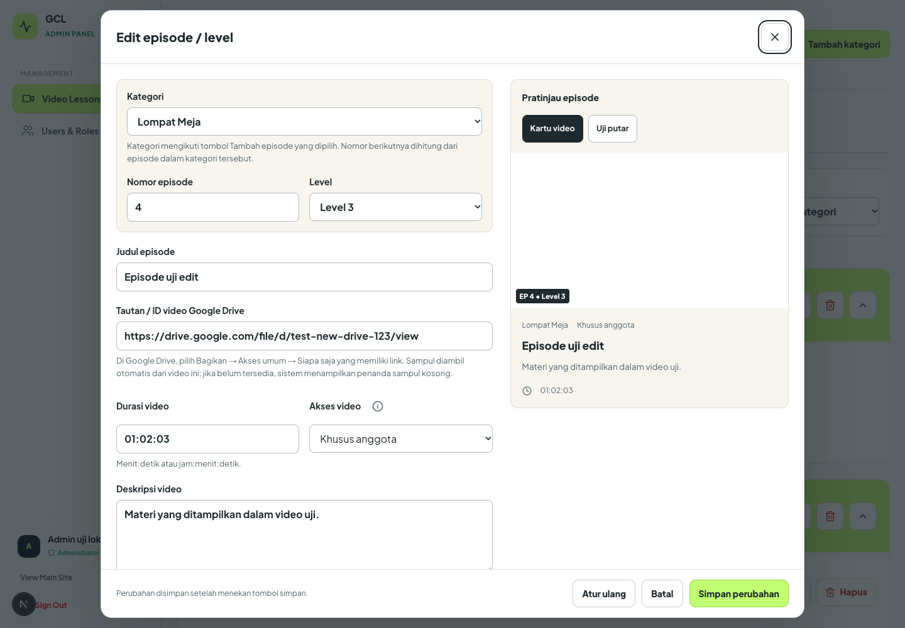
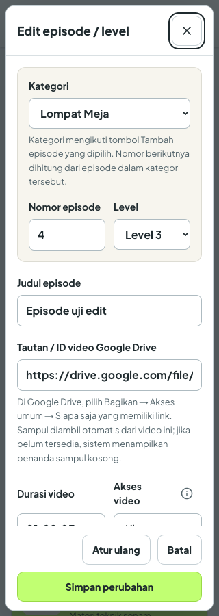
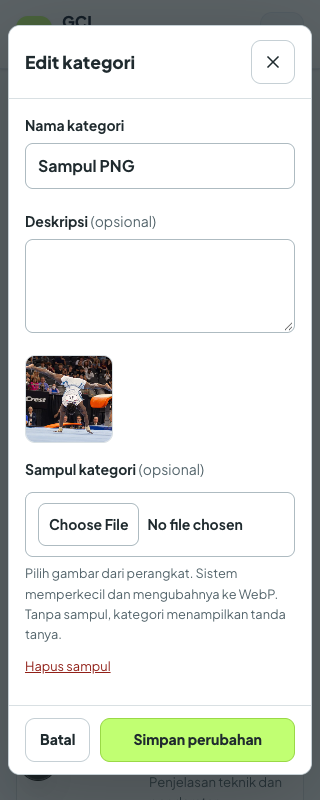
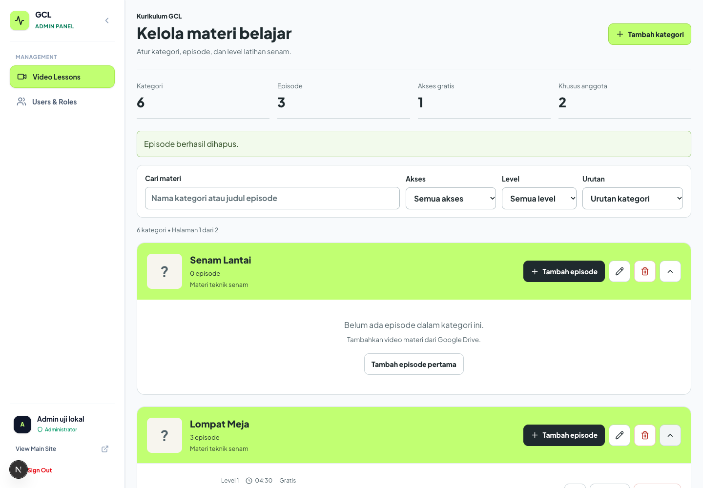

# Perbaikan pengelolaan kategori dan episode

Pembacaan desain sebelum implementasi: pengelolaan materi untuk admin GCL, mengikuti lime/charcoal, tipografi aplikasi, dan permukaan putih/cream yang disetujui. ENERGY 2 / RHYTHM 2 / MOTION 1. Fokus formulir adalah penyimpanan episode; judul kategori menjadi penanda kelompok. Tata letak beralih dari formulir dan pratinjau berdampingan menjadi satu kolom pada ruang sempit.

Alasan visual: lime menandai kategori dan tindakan simpan, charcoal untuk teks dan tombol sekunder utama. Ikon pensil, sampah, mata, dan informasi menyatakan tindakan nyata. Sampul kategori kosong memakai tanda tanya sesuai permintaan. Pratinjau episode memakai cuplikan Google Drive, tanpa ilustrasi pengganti. Outline keyboard terlihat, dialog native menahan fokus dan mengembalikannya saat ditutup. Tooltip akses bisa dibuka dengan hover, fokus, dan ketuk.

## Perubahan dan penyebab

- Pembuatan kategori sebelumnya menyimpan ID kosong. Frontend menganggap ID itu sebagai keadaan tambah, sehingga tombol edit kembali melakukan POST; DELETE mengarah ke `/categories/` dan mendapat 404. Backend sekarang menghasilkan ID dan urutan terakhir, termasuk saat pembuatan bersamaan.
- Migrasi startup memperbaiki kategori ber-ID kosong, memindahkannya ke urutan terakhir, dan mempertahankan relasi video serta teknik. Sampul lantai otomatis yang sebelumnya dipaksakan pada kategori tersebut dihapus.
- Sampul kategori opsional. Browser menerima format gambar yang bisa didekode, memperkecil ke maksimal 1280 px dan mengonversi ke WebP. Sampul maksimal 512 KB disimpan di PostgreSQL, sehingga tidak hilang saat container dibuat ulang. Browser menampilkan pesan jika format tidak dapat dibaca. Kategori tanpa sampul memakai tanda tanya.
- Formulir kategori dan episode memakai bahasa Indonesia. Kategori mengikuti tombol tambah yang dipilih, nomor episode berikutnya dihitung dari kategori itu, dan pengeditan mempertahankan nomor serta level yang tersimpan.
- Durasi dan dropdown akses terdapat pada formulir tambah maupun edit. Tooltip menjelaskan gratis dan akses setelah login. Baris episode hanya menampilkan informasi ini, tanpa toggle atau editor durasi terpisah.
- Thumbnail video manual dan Quick Suggestions dihapus. Backend selalu menyajikan endpoint cuplikan video Drive terkait. Jika Drive belum menyediakan thumbnail atau video tidak dibagikan dengan benar, komponen menampilkan penanda kosong.
- Penyimpanan yang gagal mempertahankan isian. Error episode terlihat dekat tombol simpan. Menutup formulir yang berubah meminta konfirmasi; dialog dapat dioperasikan dengan keyboard.
- Penanda kurikulum awal mencegah kategori/episode bawaan yang telah dihapus muncul kembali setelah restart. Pada instalasi yang sudah berisi kategori, materi tidak diisi ulang saat penanda ini pertama diperkenalkan.

## Hasil teknis

| Pemeriksaan | Hasil |
| --- | --- |
| `npm run build -- --webpack` | PASS, TypeScript dan seluruh route; 10 halaman statis |
| `npm run lint -- --quiet` | PASS, tanpa error |
| `TEST_DATABASE_URL=... go test ./... -count=1` | PASS, 19 tes dengan PostgreSQL lokal dalam schema terisolasi |
| `git diff --check` | PASS |

Tes backend memakai PostgreSQL 14 lokal pada port 55438. Setiap tes membuat dan menghapus schema sendiri; database produksi tidak diakses. Browser menjalankan aplikasi Next.js lokal dengan fixture API yang mendukung POST/PUT/DELETE; tidak membuat akun atau materi produksi. Screenshot menampilkan data uji, bukan konten produksi. Gambar putih pada pratinjau episode di screenshot berasal dari fixture thumbnail satu piksel untuk menguji URL video terkait.

## Bukti alur

- PASS: kategori baru tanpa sampul mendapat ID unik, masuk urutan terakhir, dan langsung terlihat pada halaman pagination terakhir.
- PASS: pembuatan kategori bersamaan di backend menghasilkan empat ID dan posisi berbeda.
- PASS: edit kategori mengirim PUT dengan ID yang sama; error server mempertahankan draft dan retry berhasil. Hapus kategori mengirim DELETE yang benar.
- PASS: upload SVG dan foto WebP asli diproses ke WebP, tersimpan, tampil kembali setelah reload, serta dapat dihapus. Berkas teks yang menyamar sebagai gambar memunculkan error.
- PASS: cover backend dapat dibaca publik, tipe dan byte gambar cocok, data non-gambar ditolak, dan update tanpa coverData mempertahankan sampul sebelumnya.
- PASS: kategori lama dengan ID kosong pulih tanpa kehilangan relasi video dan teknik; migrasi kedua tidak menggandakan data.
- PASS: tambah dari Lompat Meja memilih kategori itu dan nomor 4; pindah ke kategori kosong memilih nomor 1.
- PASS: tambah episode menyimpan judul, deskripsi, Drive ID, durasi, level, akses, dan checklist. Sampul serta uji putar memakai Drive ID yang sama.
- PASS: edit episode yang sudah ada mempertahankan nomor/level awal, dapat mengganti durasi dan akses, dan hasilnya tetap ada setelah reload.
- PASS: durasi `04:99` dan nomor episode yang sudah dipakai ditolak di formulir. Format `01:02:03` diterima dan disimpan.
- PASS: mengurutkan ulang checklist dengan teks sama mempertahankan ID-nya; tes backend juga memverifikasi pemeliharaan progres pengguna.
- PASS: hapus episode membersihkan checklist, progres, dan catatan terkait. Hapus kategori membersihkan video dan teknik. Pemanggilan startup ulang tidak mengembalikan materi terhapus.
- PASS: user biasa ditolak saat membuat kategori atau mengubah/menghapus video admin.
- PASS: pencarian, filter akses/level, urutan nama, hapus filter, ukuran pagination, buka/tutup kategori, reset formulir, dan konfirmasi buang perubahan dijalankan.
- PASS: error pemuatan dapat dicoba ulang; kegagalan penyimpanan kategori maupun episode tidak menghilangkan isian.
- PASS: daftar dan formulir episode tidak overflow pada lebar 320, 375, 768, 1024, 1440 px. Formulir kategori tidak overflow pada 320, 375, 768, 1440 px.
- PASS: teks akar 200% pada mobile dan CSS zoom 200% desktop tidak menyebabkan overflow dialog.
- PASS: Tab/Shift+Tab tetap berada di dialog, Escape menutupnya, dan tooltip akses terlihat melalui fokus keyboard. Ikon informasi mempunyai area sentuh 44 x 44 px.
- PASS: tidak ada error JavaScript browser pada alur utama.

## Antislop delivery gate

- R-02 PASS: teks baru tidak memakai em dash; label formulir berbahasa Indonesia.
- R-03 PASS: pengukuran browser pada lima lebar serta zoom di atas tidak menemukan overflow.
- R-17 PASS: angka statistik dihitung dari kategori/video API; tidak menambah statistik pelanggan.
- R-18 PASS: tidak menambahkan testimonial.
- R-23 PASS: placeholder tanda tanya diminta pengguna; unggahan menggunakan file pilihan admin.
- R-24 PASS: tautan lihat episode mempertahankan route watch yang ada.
- R-25 PASS: contrast checker menghasilkan ink/lime 12,47:1; muted/cream 5,74:1; placeholder/white 4,85:1; danger/white 6,57:1.
- R-26 PASS: tambah/edit/hapus, upload/hapus sampul, filter, pagination, tab pratinjau, uji putar, tooltip, reset, dan batal mempunyai perilaku nyata dan diuji.
- R-27 PASS: loading, kosong, error pemuatan, error simpan, retry, dan berhasil mempunyai keadaan tersendiri.
- R-28 PASS: tidak mengubah FAQ.
- R-32 PASS: kontrol native, dialog modal native, outline fokus, Tab/Shift+Tab, serta Escape diperiksa.
- R-33 PASS: UI ditulis langsung pada TSX/CSS module; skrip browser hanya menguji aplikasi.
- R-34 PASS: editor memakai permukaan terang yang konsisten dengan palet yang disetujui; tidak menambah toggle tema.
- R-35 PASS: aplikasi dibuild dan diuji melalui browser; screenshot desktop/mobile diperiksa.
- R-36 PASS: tidak menambahkan klaim keamanan, performa, atau pelanggan.
- R-37 PASS: arah desain ditetapkan sebelum implementasi berdasarkan palet serta permintaan pengguna.
- R-38 PASS: konten produksi berasal dari API/admin; konten screenshot dinyatakan sebagai fixture lokal.
- R-01 PASS: lime memberi penanda kategori dan simpan, tanpa gradient dekoratif.
- R-04 PASS: pensil/sampah/mata/informasi menjelaskan tindakan; tidak menambahkan sparkle.
- R-06 PASS: mempertahankan font Plus Jakarta Sans aplikasi, judul dan label mengikuti hierarki pengelolaan materi.
- R-07 PASS: tidak menambah pola latar.
- R-08 PASS: tidak menambah panah dekoratif pada CTA.
- R-09 PASS: metadata hanya berisi episode, level, durasi, dan akses sebenarnya.
- R-10 PASS: tidak menambah glassmorphism.
- R-12 PASS: shadow hanya memberi elevasi dialog modal.
- R-13 PASS: tidak menambah glow.
- R-14 PASS: struktur mengikuti kategori dan daftar episode, bukan kartu fitur pemasaran.
- R-19 PASS: tanpa animasi masuk dekoratif; MOTION 1 dipertahankan.
- R-22 PASS: tidak menambah ilustrasi generatif.
- Liveliness PASS: ENERGY 2 / RHYTHM 2 / MOTION 1; fokus pada simpan, motif lime pada kelompok kategori, variasi antara daftar dan editor, whitespace memisahkan konteks/isi/pratinjau.
- C-1 PASS: alasan warna, struktur, ikon, dan placeholder tertulis di atas.
- C-2 PASS: CRUD diverifikasi di API dan browser; draft tidak dibuang saat gagal.
- C-3 PASS: setiap bidang melayani materi, akses, durasi, atau progres belajar.
- C-4 PASS: keadaan gagal/kosong, mobile, keyboard, dan zoom diuji.
- C-5 PASS: statistik berasal dari data, screenshot fixture dinyatakan eksplisit.
- R-05/R-11 PASS: hierarki kategori-episode dan radius 8/12/16 px membedakan kontrol serta kelompok.
- R-15/R-16 PASS: CTA menyebut tindakan tambah, simpan, edit, dan hapus; saran judul generik dihapus.
- R-20/R-21 PASS: identitas GCL dipertahankan dan editor terang mengikuti kebutuhan keterbacaan pengguna.
- R-29/R-30 PASS: charcoal, putih/cream, dan lime aplikasi; warna merah terbatas pada error/hapus. Tidak meniru shell produk lain.
- R-31 PASS: alasan keputusan visual tercatat pada pembacaan desain dan paragraf alasan.

## Pratinjau









## Penerapan produksi

Perubahan saat validasi ini masih lokal, belum di-push atau dideploy. Frontend dan backend perlu dirilis bersama. Setelah kode tersedia di VPS, jalankan dari root repo:

```bash
docker compose up -d --build backend
docker compose logs --tail=60 backend
curl -fsS https://api.gymnasticcomplevel.com/api/health
```

Migrasi tabel dan perbaikan ID berjalan otomatis saat backend mulai. Tidak memerlukan perubahan Nginx, volume upload, atau variabel Vercel baru. Deploy ulang frontend Vercel dengan API HTTPS yang sudah dipakai.
