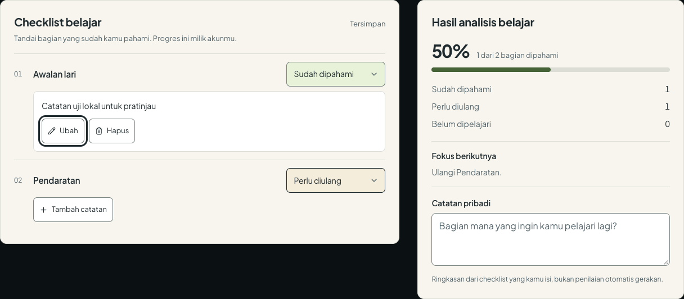
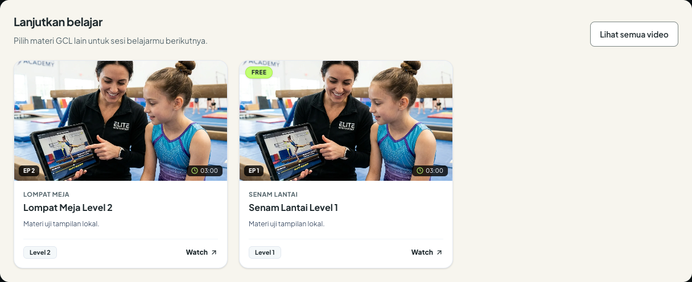
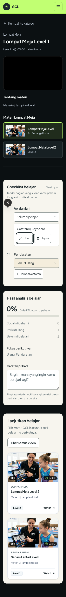

# Validasi UI belajar GCL

23 Oktober 2026. Cakupan: panel tracker terang, catatan per item, dropdown status, navigasi setelah login, serta bagian Lanjutkan belajar. Semua interaksi browser dijalankan pada aplikasi Next.js lokal dengan API dan Google sign-in yang diintersep memakai data uji. Tidak ada perubahan data produksi atau akun Google sebenarnya.

Pembacaan desain: halaman belajar pengguna GCL, mengikuti lime dan charcoal yang ada, dengan panel cream sesuai permintaan pengguna. ENERGY 2 / RHYTHM 2 / MOTION 1. Cream memisahkan area membaca dan menulis dari pemutar video; kontrol putih memperjelas area input.

## Pemeriksaan teknis

| Pemeriksaan | Hasil |
| --- | --- |
| TypeScript `npx tsc --noEmit` | PASS |
| ESLint `npm run lint -- --quiet` | PASS, tanpa error |
| Build produksi `npm run build -- --webpack` | PASS, seluruh route dan 9 halaman statis |
| `git diff --check` | PASS |
| Browser 320, 520, 768, 1024, 1440 px | PASS, tidak ada luapan horizontal pada halaman dan tracker |
| Pembesaran CSS 200% pada viewport 640 px | PASS, tidak ada luapan horizontal |

## Interaksi browser

- PASS: Tambah catatan membuka editor dan memindahkan fokus ke textarea. Mengetik belum mengirim perubahan.
- PASS: Simpan membuat catatan terlihat dan mengirim isi catatan ke endpoint item yang sama.
- PASS: Ubah lalu Simpan mengirim isi baru. Batal mempertahankan catatan sebelumnya.
- PASS: Hapus menampilkan konfirmasi. Batal mempertahankan isi; konfirmasi mengirim catatan kosong.
- PASS: Simpan dapat dijalankan dengan Tab dan Enter; fokus kembali ke aksi catatan setelah editor ditutup.
- PASS: Status dropdown mengirim nilai baru, mengubah warna yang disertai label teks, dan memperbarui ringkasan sesuai jumlah item.
- PASS: Kegagalan penyimpanan mempertahankan draft yang terlihat; Coba simpan lagi mengirim ulang dan berhasil.
- PASS: State tamu, checklist kosong, dan gagal memuat tracker tetap terbaca pada panel terang.
- PASS: Login user melalui halaman masuk maupun popup menuju `/#katalog-video`, termasuk jika URL masuk sebelumnya meminta `/admin`.
- PASS: Login admin melalui halaman masuk maupun popup menuju `/admin`.
- PASS: Login gagal tetap berada di halaman masuk dan menampilkan pesan kesalahan.
- PASS: Bagian Lanjutkan belajar memakai video katalog selain video aktif. Kartu membuka materi yang dipilih; Lihat semua video menuju katalog.

## Antislop delivery gate

- R-02 PASS: teks baru tidak memakai em dash.
- R-03 PASS: pengukuran pada lima lebar viewport tidak menemukan overflow; screenshot desktop dan mobile diperiksa.
- R-17 PASS: persentase tetap dihitung dari status checklist; tidak ada angka aktivitas pengguna baru.
- R-18 PASS: tidak ada testimonial atau orang rekaan yang ditambahkan.
- R-23 PASS: tidak membuat aset visual atau identitas baru; kartu materi memakai komponen VideoCard dan data katalog yang ada.
- R-24 PASS: tautan materi mengarah ke `/watch/:id`; tautan katalog mengarah ke anchor yang ada.
- R-25 PASS: teks utama pada cream 13,47:1; teks sekunder pada cream 5,74:1; teks sekunder pada putih 6,27:1.
- R-26 PASS: tombol tambah, simpan, batal, ubah, konfirmasi hapus, retry, kartu materi, dan tautan katalog dijalankan di browser lokal.
- R-27 PASS: state tamu, kosong, gagal memuat, gagal menyimpan, dan retry diperiksa di browser lokal.
- R-28 PASS: tidak mengubah atau menambahkan FAQ.
- R-32 PASS: kontrol native tetap dapat difokuskan; Tab/Enter menyimpan catatan; outline charcoal pada putih 14,70:1.
- R-33 PASS: perubahan UI ditulis pada sumber TSX/CSS Modules; tidak ada stylesheet produk yang dipatch oleh script eksternal.
- R-34 PASS: komponen tracker menetapkan `color-scheme: light`; teks, textarea, dropdown, dan hover memakai warna yang sesuai.
- R-35 PASS: build produksi dan alur interaksi lokal di atas selesai diperiksa. API produksi tidak digunakan untuk pengujian tulis.
- R-36 PASS: tidak menambahkan klaim keamanan, performa, atau pelanggan.
- R-37 PASS: arah warna berasal dari permintaan pengguna dan identitas aplikasi yang sudah ada.
- R-38 PASS: materi tambahan berasal dari API katalog; isi screenshot secara eksplisit merupakan data uji lokal.
- R-01/R-07/R-10/R-12/R-13/R-22 PASS: tidak menambahkan gradient, grid dekoratif, glass, glow, atau ilustrasi.
- R-04 PASS: Plus, Pencil, Trash2, dan ChevronDown memakai sistem ikon yang ada untuk aksi tambah, ubah, hapus, dan pilihan status.
- R-06 PASS: tipografi tetap memakai Plus Jakarta Sans aplikasi; tidak menambah font dekoratif.
- R-08/R-09 PASS: tidak menambahkan panah atau badge dekoratif baru pada panel tracker.
- R-14 PASS: baris checklist, ringkasan, dan kartu materi mempunyai struktur sesuai peran masing-masing.
- R-19 PASS: tidak menambahkan animasi; interaksi baru memakai perubahan state langsung.
- Liveliness PASS: angka persentase menjadi fokus ringkasan; baris input, ringkasan, dan bagian materi dibedakan melalui struktur dan ruang. Lime tetap menjadi aksen aksi utama.
- C-1/C-2/C-3 PASS: cream meningkatkan keterbacaan, putih menandai input, dan bagian materi tambahan diminta pengguna serta memakai data katalog.
- C-4/C-5 PASS: pembesaran CSS 200%, keyboard, error/retry, dan viewport sempit diperiksa; tidak ada klaim data produksi pada fixture.
- R-05/R-11/R-15/R-16/R-20/R-21/R-29/R-30/R-31 PASS: mempertahankan struktur belajar GCL, radius sesuai komponen yang ada, label aksi spesifik, serta palet cream/charcoal/lime dengan hijau progres dan merah konfirmasi hapus yang fungsional.

## Kontras kontrol

- PASS: batas dropdown terhadap putih 3,80:1; cream 3,48:1; status Perlu diulang 3,26:1; status Sudah dipahami 3,27:1.
- PASS: indikator progres terhadap track 5,00:1.
- PASS: teks tombol pada lime 12,47:1; border hijau pada lime 5,76:1.
- PASS: teks aksi hapus pada latar normal 6,68:1 dan hover 6,02:1.

## Screenshot lokal

Nama video, gambar, catatan, dan persentase pada gambar berikut dipasok fixture untuk pengujian tampilan. Gambar bukan bukti isi akun produksi atau pemutaran video.

