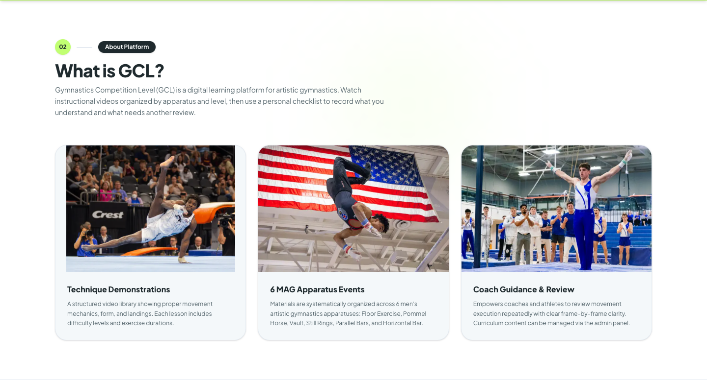
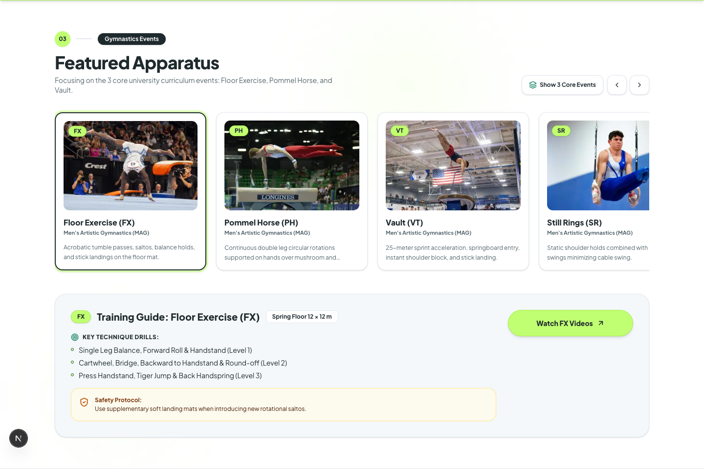

# Verifikasi navbar dan foto dokumentasi GCL

Cakupan: menampilkan kategori alat tanpa menu More, mengganti foto yang ditunjukkan klien dengan dokumentasi senam putra asli, serta mengoptimalkan dan mengatribusikan foto tersebut. Pemeriksaan browser memakai aplikasi Next.js lokal dengan respons API berupa fixture. Data produksi tidak diubah.

Pembacaan desain: navbar dan kartu materi untuk pengguna GCL, mempertahankan identitas lime/charcoal dan tipografi aplikasi. ENERGY 2 / RHYTHM 2 / MOTION 1. Desktop menampilkan semua kategori dalam satu baris; layar lebih sempit memakai satu daftar kategori dalam drawer. Bingkai foto mengikuti proporsi dokumentasi agar atlet dan alat tetap terlihat.

## Hasil teknis

| Pemeriksaan | Hasil |
| --- | --- |
| Build produksi `npm run build -- --webpack` | PASS, termasuk TypeScript, seluruh route, dan 10 halaman statis |
| ESLint `npm run lint -- --quiet` | PASS, tanpa error |
| `git diff --check` | PASS |
| Sembilan berkas gambar | PASS, format WebP, lebar 1440 px, metadata ukuran cocok dengan berkas |
| Ukuran aset gambar | 1.001.552 byte total; sekitar 61–167 KiB per foto |
| Kredit | PASS, sembilan entri dengan sumber, fotografer, lisensi, dan catatan perubahan |

## Alur browser

- PASS: tamu, user, dan admin melihat keenam kategori dalam satu baris pada lebar 1280, 1366, 1440, dan 1600 px, tanpa overflow.
- PASS: setiap tautan kategori desktop mempunyai tinggi minimal 44 px.
- PASS: menu More dihapus. Keenam kategori tersedia dalam satu daftar pada menu mobile/tablet di lebar 320, 768, 1024, dan 1279 px.
- PASS: Escape menutup drawer; memilih Horizontal Bar membuka video pertama kategori itu dan menutup drawer.
- PASS: menu akun user dan admin tetap dapat dibuka serta ditutup dengan Escape.
- PASS: fokus keyboard pada navbar solid memakai outline charcoal 2 px; pada navbar transparan memakai lime 2 px. Warna diperiksa sesudah transisi selesai.
- PASS: tiga foto pengenalan platform dan enam foto alat dimuat melalui komponen Image tanpa error gambar. Kartu memakai object-contain untuk mempertahankan subjek foto.
- PASS: halaman utama tidak overflow pada lebar 320, 768, 1024, dan 1440 px.
- PASS: tautan kredit dari footer membuka `/photo-credits`, berisi sembilan tautan sumber dan sembilan tautan lisensi.
- PASS: halaman kredit tidak overflow pada lebar 320, 768, dan 1440 px.
- PASS: visual halaman masuk memakai foto asli yang baru; tautan kreditnya berfungsi.

## Antislop delivery gate

- R-02 PASS: teks antarmuka baru tidak memakai em dash. Judul karya asli dipertahankan pada atribusi.
- R-03 PASS: pengukuran desktop dan mobile di atas tidak menemukan overflow halaman; carousel alat tetap mempunyai scroll internal.
- R-17 PASS: tidak menambahkan statistik pengguna; angka ukuran berkas berasal dari pemeriksaan aset lokal.
- R-18 PASS: tidak menambahkan testimonial atau identitas pelanggan.
- R-23 PASS: penggantian foto diminta pengguna; sumber foto dokumenter dan atribusinya tercatat.
- R-24 PASS: kategori tetap membuka materi pertama atau katalog; halaman kredit dan tautan kembali ke GCL berfungsi.
- R-25 PASS: ink pada lime 12,47:1; teks sekunder pada cream 5,74:1; tautan kredit footer pada latar gelap 11,05:1.
- R-26 PASS: kategori desktop/mobile, menu akun, Escape, toggle alat, serta tautan kredit dijalankan pada browser lokal.
- R-27 PASS: pemuatan data navbar mempertahankan perilaku aplikasi; pemuatan foto diverifikasi tanpa gambar rusak.
- R-28 PASS: tidak mengubah FAQ.
- R-32 PASS: tautan tetap native; indikator fokus pada kedua keadaan navbar diverifikasi dengan Tab.
- R-33 PASS: perubahan UI ditulis pada sumber TSX; pengolahan Pillow terbatas pada foto yang secara eksplisit diminta untuk dikonversi.
- R-34 PASS: warna fokus mengikuti navbar solid dan transparan; halaman kredit memakai permukaan terang dengan teks gelap.
- R-35 PASS: build produksi dan pemeriksaan browser selesai; screenshot desktop diperiksa secara visual.
- R-36 PASS: tidak menambahkan klaim performa layanan, keamanan, atau pelanggan.
- R-37 PASS: arah visual mengikuti navbar/kartu aplikasi dan permintaan klien.
- R-38 PASS: foto atlet, fotografer, dan lisensi berasal dari metadata sumber; tidak ada gambar generatif baru.
- R-01/R-07/R-10/R-12/R-13/R-22 PASS: tidak menambahkan gradient, grid dekoratif, glass, glow, atau ilustrasi baru.
- R-04/R-06/R-08/R-09 PASS: mempertahankan ikon dan tipografi aplikasi; menghapus ikon dropdown More tanpa menambah dekorasi baru.
- R-14/R-19 PASS: struktur kartu dipertahankan; bingkai foto mengikuti proporsi asli dan tidak menambah animasi.
- Liveliness PASS: identitas lime/charcoal dipertahankan; foto alat dan foto konteks platform mempunyai peran berbeda; whitespace navbar dipakai untuk kategori langsung.
- C-1/C-2/C-3 PASS: kategori terlihat langsung sesuai permintaan; foto nyata sesuai nomor alat; atribusi disediakan untuk penggunaan foto berlisensi.
- C-4/C-5 PASS: drawer tetap dapat discroll pada layar pendek, tindakan keyboard diuji, dan tidak menambah konten pengguna fiktif.
- R-05/R-11/R-15/R-16/R-20/R-21/R-29/R-30/R-31 PASS: menggunakan struktur, radius, label, dan palet GCL yang sudah ada; tidak menambahkan shell atau komponen dekoratif baru.

## Pratinjau lokal

Foto pada screenshot adalah aset dokumenter yang sama dengan implementasi. Data katalog di luar bagian yang diperiksa berasal dari fixture lokal.

Daftar sumber foto dan lisensi tersedia pada [photo-sources.md](photo-sources.md). Perubahan belum di-push atau dideploy oleh agen.
