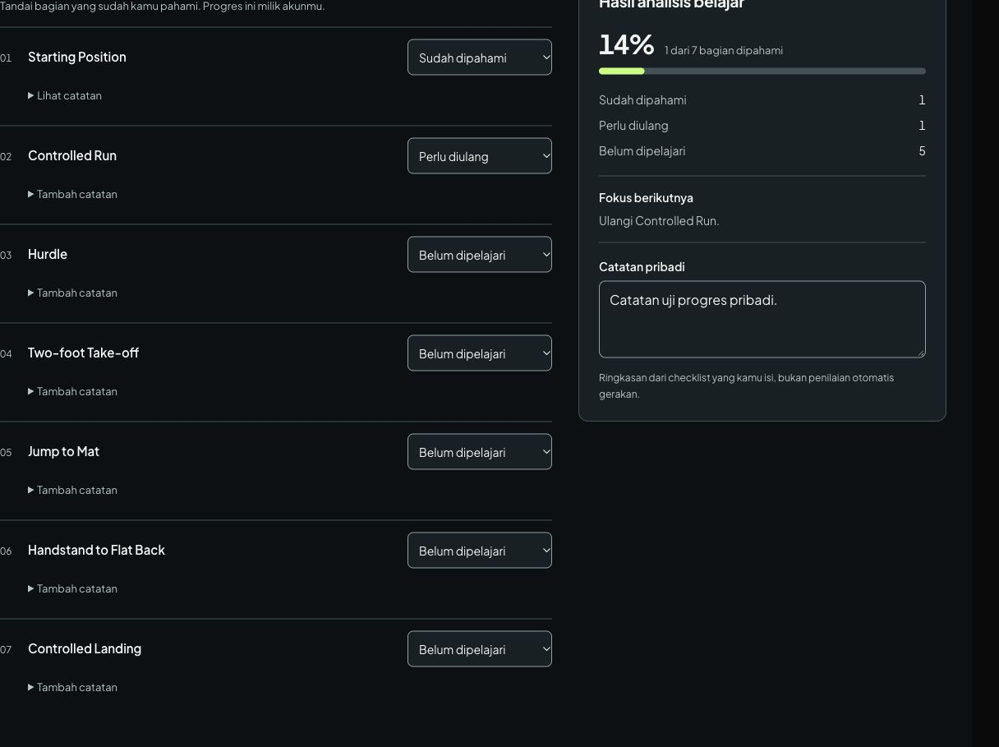
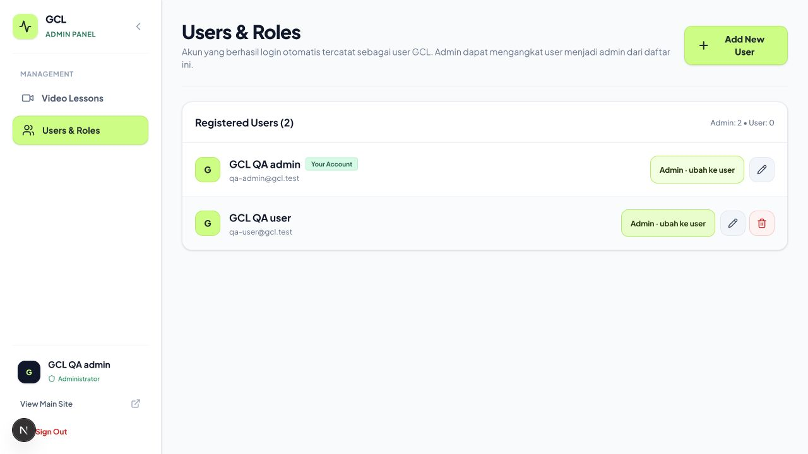

# Verifikasi implementasi GCL

Implementasi dan pemeriksaan dilakukan pada 23 Oktober 2026. Pengujian memakai PostgreSQL terisolasi dan akun QA; data produksi tidak diubah.

## Hasil pemeriksaan

| Pemeriksaan | Hasil |
| --- | --- |
| `npm --prefix frontend run build -- --webpack` | PASS, termasuk TypeScript dan seluruh route aplikasi. |
| `npm run lint` | PASS, tanpa error. Dua warning avatar `` yang sudah ada tetap tercatat. |
| Tes integrasi backend dengan `TEST_DATABASE_URL` | PASS, 14 tes PostgreSQL. |
| `go vet ./...` | PASS. |
| `git diff --check` | PASS. |

Build Turbopack default tidak dapat selesai dalam lingkungan pengujian karena proses CSS ditolak ketika membuka port internal. Build produksi yang diverifikasi memakai opsi Webpack resmi Next.js. Percobaan awal juga memerlukan akses Google Fonts untuk font yang sudah digunakan proyek.

## Alur yang diperiksa di browser

- Tamu membuka video gratis dan memperoleh pemutar Google Drive dari sumber sebenarnya.
- Tamu membuka Level 2 dan memperoleh ajakan login; pemutar materi terkunci tidak ditampilkan.
- Dialog login terbuka, fokus berada di dalam dialog, Escape menutupnya, dan fokus kembali ke pemicu.
- Akun uji masuk melalui API nyata yang terhubung ke database terisolasi.
- Status Starting Position menjadi Sudah dipahami; Controlled Run menjadi Perlu diulang; ringkasan menjadi 1 dari 7 bagian atau 14%.
- Catatan per item dan catatan pribadi tersimpan. Status dan catatan tetap tersedia setelah halaman dimuat ulang dan API dimulai ulang.
- Video Level 2 tetap mempunyai progres 0%. Akun admin yang berbeda juga memperoleh progresnya sendiri, bukan progres akun user.
- Saat API dihentikan, perubahan tetap terlihat dengan keterangan belum tersimpan. Setelah API aktif lagi, tombol Coba simpan lagi berhasil mengubah status menjadi Tersimpan.
- Manajemen user memuat kedua akun uji dari database. Tombol promosi mengubah jumlah admin dari satu menjadi dua dan menampilkan aksi demosi.
- Form video memuat deskripsi, thumbnail otomatis dari sumber video, serta editor checklist per video. Label dan pilihan level dinormalisasi menjadi Level 1/2/3.
- Thumbnail sumber Drive mengembalikan gambar asli melalui proxy backend. Perubahan sumber memperbarui versi URL thumbnail agar gambar lama tidak terus digunakan.
- Pada lebar viewport 320, 768, dan 1024 piksel, pengukuran tidak menemukan luapan horizontal pada halaman menonton dan kontrol tracker. Layout tracker diperiksa pada HP.

Verifikasi identitas Google pada tes backend memakai respons Google yang dimock. Pengujian tidak membuat atau mengubah akun Google sungguhan. Route login khusus QA yang dipakai untuk pemeriksaan browser telah dihapus dan tidak muncul pada hasil build produksi.

## Cakupan tes backend

Tes meliputi registrasi Google satu kali saat login bersamaan; audience/email terverifikasi; penolakan gangguan database; bootstrap admin; promosi/demosi pada JWT lama; batas akses video dan metadata; pemisahan tracker antar akun/video; validasi status/catatan; ID checklist stabil; seed tidak menimpa metadata admin; sumber/versioning thumbnail; alias level lama; akun Google kelolaan admin tanpa password bersama; serta penolakan password demo lama.

Dua tes interleaving database memastikan perubahan profil tidak dapat memulihkan role admin yang sudah dicabut dan perubahan role tidak menimpa perubahan profil lain.

## Antislop selama perancangan

Pembacaan desain: halaman belajar pribadi untuk pengguna GCL, mengikuti identitas lime/charcoal dan tipografi yang sudah dipakai aplikasi. ENERGY 2 / RHYTHM 2 / MOTION 1.

- Hard Gate PASS: konten checklist berasal dari kurikulum proyek; data QA pada gambar ditandai sebagai pengujian; loading/empty/error/retry tersedia; kontrol dan layout HP diperiksa. Kontras teks tracker 9,23:1, batas kontrol 6,00:1, dan teks tombol pada lime 12,47:1.
- Purpose-Gate PASS: video menjadi konteks utama; baris checklist memisahkan input dari satu panel ringkasan; lime dipakai untuk progres, aksi utama, dan fokus. Tipografi mengikuti aplikasi agar antarmuka tetap konsisten.
- Liveliness PASS: identitas GCL dipertahankan, komposisi video/checklist/ringkasan mempunyai hierarki berbeda, tanpa menambahkan shell dashboard atau dekorasi bergerak.
- Craftsmanship PASS: alur simpan, kegagalan dan retry, pemisahan data, dialog keyboard, pemutaran gratis/terkunci, serta build produksi diverifikasi. Kontrol berulang berbagi handler yang sama; authoring checklist dan metadata juga diuji pada API.

## Gambar hasil pengujian lokal

Angka progres dan nama akun pada gambar berikut adalah data pengujian, bukan klaim aktivitas pengguna produksi.

## Konfigurasi saat dijalankan

Backend memerlukan `JWT_SECRET`, `GOOGLE_CLIENT_ID` yang sama dengan frontend, koneksi PostgreSQL, dan `ADMIN_EMAILS` untuk bootstrap admin awal. Origin frontend harus diizinkan pada konfigurasi OAuth Google dan CORS backend. `PUBLIC_API_URL` dapat diisi bila API berada di balik reverse proxy. Lihat README backend untuk detail.

Migrasi dan seed otomatis menambah tabel tracker serta checklist awal sekali. Konten dan checklist yang sudah diedit admin tidak ditimpa pada startup berikutnya. Implementasi ini belum dideploy.
